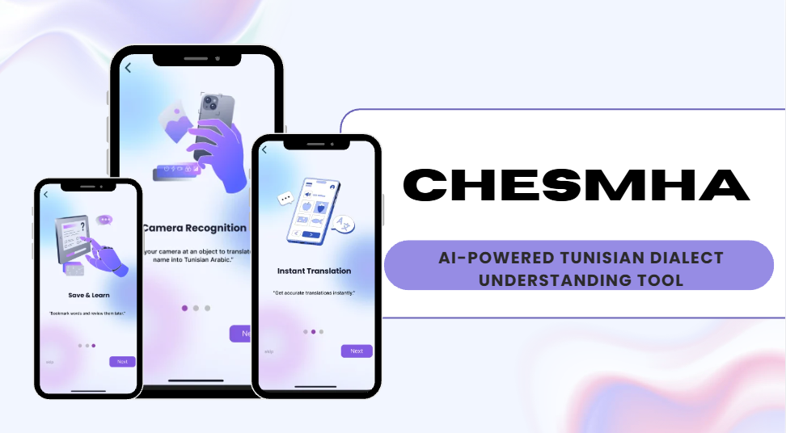

# Chesmha — Speech Therapy & Communication Assistant

**Chesmha** is a mobile application designed to support individuals with aphasia who experience difficulties communicating in everyday situations, and provides real-time pronounciation and translation across Tunisian arabic and english.

<p align="center">
  <!-- Replace with the path to your main application screenshot -->
  
</p>

<p align="center">
  
  
  
  
  
  
  
  
  
</p>

## Key Features

- **Object Recognition:** Identifies everyday objects using an external AI API, helping users communicate what they see.
- **Dialectal Translation:** Translates English text into Tunisian Arabic using a locally hosted NLLB model.
- **Text-to-Speech:** Converts translated text into spoken Arabic audio using a local speech generation model.
- **Everyday Vocabulary:** Provides predefined everyday items stored in MongoDB Atlas, which users can access for translation or pronunciation.
- **User Authentication:** Supports account registration and login through JWT-based authentication.

## Architecture

Chesmha combines a React Native mobile application with an Express.js backend and two locally hosted AI services.

| Component           | Technology                 | Responsibility                                      |
| ------------------- | -------------------------- | --------------------------------------------------- |
| Mobile Application  | React Native               | User interface and application workflows            |
| Main Backend        | Node.js, Express.js        | API endpoints, authentication and application logic |
| Database            | MongoDB Atlas              | User data and predefined everyday vocabulary        |
| Translation Service | FastAPI, NLLB, CTranslate2 | English-to-Tunisian Arabic translation              |
| Speech Service      | FastAPI, `tts_arabic`      | Arabic speech generation and audio retrieval        |
| Object Recognition  | External AI API            | Everyday object identification                      |

The translation and speech services run locally, while object recognition relies on an external AI API.

## Getting Started

### Prerequisites

- Node.js and npm
- MongoDB Atlas account
- Python environment for the AI services
- Required local AI model files

### 1. Clone the repository

```bash
git clone https://github.com/Rahma-sbei/Chesmha-Speech-therapy-app.git
cd Chesmha-Speech-therapy-app
```

### 2. Install dependencies

Install the Node.js dependencies for the frontend and backend:

```bash
npm install
```

Run this command from each respective project directory if they have separate `package.json` files.

### 3. Configure environment variables

Create the required `.env` files using the corresponding `.env.example` templates.

The main backend requires:

```env
PORT=your_port
URL=your_mongodb_atlas_connection_string
JWT_SECRET=your_jwt_secret
```

Configure the external AI API credentials where required.

### 4. Set up the AI services

The translation and speech services require locally available model files and their own Python dependencies.

Refer to the dedicated documentation for model downloads, configuration, and startup instructions:

**[TTS & Translation Setup](./tts/README.md)**

### 5. Run the application

Start the frontend and backend from their respective directories using the scripts defined in their `package.json` files.

```bash
npm start
```

The AI services must also be running and accessible to the application.

## Project Objective

Chesmha explores how AI-powered object recognition, dialectal translation, and speech synthesis can be combined into an accessible mobile communication assistant.

By focusing on Tunisian Arabic and everyday communication scenarios, the project aims to provide a tool better adapted to the linguistic and practical needs of its intended users.

---

**Developed as an academic software engineering project.**
